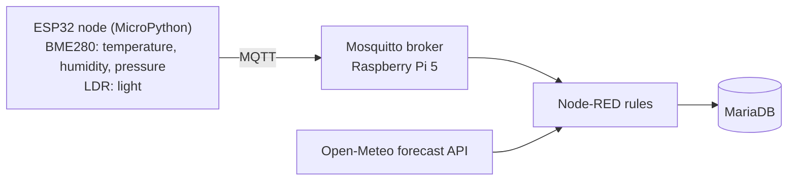

# Environmental monitoring with MQTT, Node-RED and MariaDB

Lab 3 of the Internet of Things (IoT) course at Universidad Iberoamericana (IBERO). An ESP32 sensor node publishes environmental readings to a Raspberry Pi 5 server, where Node-RED combines them with a weather forecast and stores everything in a database.

## Architecture



- **Sensor node:** ESP32 running MicroPython. Publishes temperature, humidity and pressure from a BME280 sensor and light from an LDR (light-dependent resistor) over MQTT (Message Queuing Telemetry Transport).
- **Server:** Raspberry Pi 5 running the Mosquitto MQTT broker, Node-RED and MariaDB.
- **Logic:** Node-RED rules combine local readings with the Open-Meteo forecast API (application programming interface) and log the data.
- **Network:** a segmented network configured with NetworkManager (`nmcli`) and `nftables`.

## Repository layout

```
esp32/       MicroPython firmware for the sensor node
node-red/    flows exported from Node-RED (flows.json)
database/    MariaDB schema
network/     nmcli and nftables configuration
```

<!-- TODO: upload your files to these folders. -->
<!-- IMPORTANT: remove Wi-Fi passwords, MQTT credentials and database passwords before uploading. -->

## MQTT topics

<!-- TODO: list the topics the node publishes and what each payload contains. -->

## Results

<!-- TODO: how long it ran and how many readings it logged; a screenshot of the Node-RED dashboard or flow. -->

## Earlier lab

Lab 2 of the same course: Node-RED and MariaDB with an LED circuit driven through GPIO (general-purpose input/output) by a state machine.
